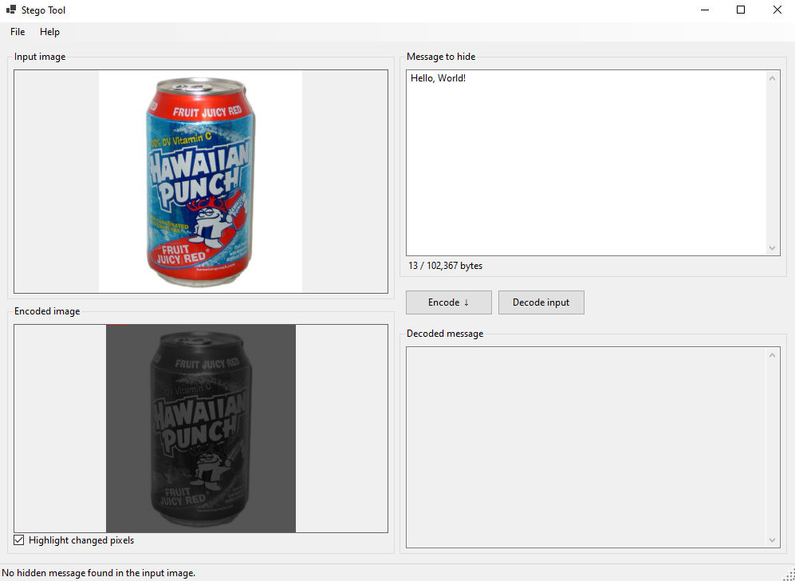

# Stego Tool

A small Windows desktop app for hiding text inside PNG images (LSB steganography) and reading it back out.



## Features

- Open an image (menu, Ctrl+O, or drag and drop) and hide a message in it
- Side-by-side preview of the original and encoded image
- **Highlight changed pixels** view shows exactly which pixels were modified
- Live capacity counter shows how many bytes the image can hold
- Decode hidden messages from any image made with the tool
- Save as PNG, or right-click → Copy Image to the clipboard
- Full UTF-8 support (accents, emoji, non-Latin scripts)
- Follows the Windows light/dark theme

## How it works

Each pixel has red, green and blue values from 0–255. The tool replaces the **least significant bit** of each channel with one bit of the message, so each pixel stores 3 bits and no color value changes by more than 1, which can't be seen.

The hidden data is laid out as:

| Bytes | Contents |
|-------|----------|
| 4     | Magic marker `STG1` (identifies an encoded image) |
| 4     | Message length, big-endian |
| N     | Message, UTF-8 |

The length header means no delimiter character is needed, so any text can be stored, and decoding an ordinary image reports "no message" instead of returning garbage.

**Limitations:** the message only survives lossless formats. Saving as JPEG, or uploading to a site that recompresses images, destroys it. The message is hidden, not encrypted: anyone with this tool can read it.

## Building

Requires Windows and the [.NET 10 SDK](https://dotnet.microsoft.com/download) (included with Visual Studio 2026's ".NET desktop development" workload).

```
dotnet run
```

or open `StegoTool.csproj` in Visual Studio and press F5.

## Project layout

- `Stego.cs`: encoding/decoding logic, independent of the UI
- `MainForm.cs`: the WinForms window, built in code
- `Program.cs`: entry point
